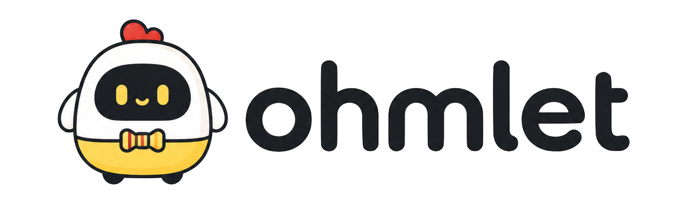

<p align="center">
  
</p>

<p align="center">
  <strong>Relay became Ohmlet.</strong><br>
  Relay was entered into the Gemini Live Agent Challenge by Google and Devpost (Live Agents category, March to April 2026) and received an Honorable Mention from a field of about 12,000 participants.<br>
  Ohmlet is the commercial product that grew out of it: a live tutor that watches your bench through the camera and talks you through the build, on the web and on iOS, at <strong><a href="https://ohmlet.org">ohmlet.org</a></strong>.<br>
  This repository is Relay as it was entered into the challenge. It is kept as a record and is not developed further; the Ohmlet code lives in a private repository.
</p>

---

# Relay


**A real-time multimodal lab assistant for learning electronics.**

Built for the [Gemini Live Agent Challenge](https://devpost.com/software/relay-real-time-voice-vision-lab-tutor-for-electronics) by Google and Devpost, **Live Agents** category. Honorable Mention, from a field of about 12,000 participants.

Relay watches your physical workspace through a webcam and guides you through electronics builds with live voice and vision. You talk to Relay while it sees your breadboard, components and wiring, and it corrects mistakes as they happen.

## How it works

1. Pick a build from the library (for example the Light-Activated Alarm)
2. Show your components: Relay verifies the inventory through the camera
3. Wire step by step: Relay guides and corrects in real time
4. Generate Arduino code: Relay writes and debugs the sketch
5. Run and validate: Relay watches the serial output and confirms
6. Get a 3D digital twin of the completed build in the sandbox

**No hardware?** The live session still runs without an Arduino. Turn on your camera and hold up any object, and Relay identifies it in real time.

## What's in the app

| Tab | What it does |
|-----|-------------|
| **Build** | Live workspace: camera feed, voice interaction, step-by-step guidance |
| **Learn** | AI-generated adaptive quizzes, drawing exercises assessed with Gemini vision, wrong-answer requeue and review history |
| **Sandbox** | 3D breadboard workspace: place components, edit wires, write Arduino code in Monaco, run circuit validation and simulation with buzzer audio |
| **Community** | Share builds, react and comment, persisted in Firestore |
| **Library** | Starter projects with 3D twin presets for the sandbox |

## Multi-model architecture

One voice session, several models working behind the scenes:

| Role | Model |
|------|-------|
| Live tutor (voice + vision) | `gemini-live-2.5-flash-native-audio` |
| Quick checks (component ID) | `gemini-2.5-flash` |
| Code generation (Arduino) | `gemini-2.5-pro` |
| Deep reasoning (debugging) | `gemini-2.5-pro` |
| Drawing assessment (vision) | `gemini-2.5-pro` |

## Architecture

```
┌──────────────────────────────────────────────────────┐
│                    Relay Frontend                    │
│        React + TypeScript + Three.js + Monaco        │
│                                                      │
│  ┌──────────┐ ┌──────────┐ ┌──────────┐ ┌──────────┐ │
│  │  Build   │ │  Learn   │ │ Sandbox  │ │Community │ │
│  │(Live AI) │ │(Quizzes) │ │  (3D)    │ │  (Feed)  │ │
│  └────┬─────┘ └────┬─────┘ └──────────┘ └────┬─────┘ │
│       │            │                         │       │
│   WebSocket    HTTP POST              Firestore REST │
│       │            │                         │       │
└───────┼────────────┼─────────────────────────┼───────┘
        │            │                         │
   ┌────▼────┐  ┌────▼─────┐           ┌───────▼──────┐
   │  Live   │  │  Quiz    │           │  Firestore   │
   │ Bridge  │  │ Engine   │           └──────────────┘
   │(Cloud   │  │(Cloud    │
   │  Run)   │  │  Run)    │
   └────┬────┘  └────┬─────┘
        │            │
   ┌────▼────┐  ┌────▼─────┐
   │  ADK    │  │ Gemini   │
   │  Bidi   │  │ Flash    │
   │Streaming│  │(genai)   │
   └────┬────┘  └──────────┘
        │
   ┌────▼──────────────────┐
   │   Gemini Models       │
   │  (Vertex AI)          │
   │                       │
   │  • Flash Native Audio │
   │  • Flash 2.5          │
   │  • Pro 2.5            │
   └───────────────────────┘
```

## Tech stack

- **Frontend:** React 18, TypeScript, Vite, Tailwind CSS
- **3D:** Three.js via @react-three/fiber and @react-three/drei
- **Code editor:** Monaco Editor
- **Live backend:** FastAPI + Google ADK (bidirectional WebSocket streaming)
- **Quiz backend:** FastAPI + google-genai SDK
- **Persistence:** Firestore
- **Deployment:** Google Cloud Run for the services, Firebase Hosting for the frontend

## Google Cloud services used

- **Cloud Run:** each backend service runs as its own Cloud Run service
- **Vertex AI:** Gemini model access through the service account, with no API key
- **Firestore:** user state, quiz history, community data
- **Google ADK:** agent framework for bidirectional audio and video streaming

## Local development

### Prerequisites

- Node.js 20
- Python 3.13 (not 3.14: pydantic-core wheels are missing)
- Google Cloud SDK (for deployment)

### 1. Frontend

The web app lives in `frontend/`.

```bash
cd frontend
npm install
npm run dev
```

Opens at `http://localhost:5173`. The app workspace is at `/app`.

Create `frontend/.env.local` with the service URLs and your own Firebase web app configuration:

```env
VITE_OHMLET_API_BASE_URL=http://localhost:8082
VITE_OHMLET_WS_URL=ws://localhost:8082
VITE_OHMLET_QUIZ_API_BASE_URL=http://localhost:8083
VITE_OHMLET_VERIFIER_API_BASE_URL=http://localhost:8084
VITE_OHMLET_REPORTER_API_BASE_URL=http://localhost:8085
VITE_OHMLET_COMPILER_API_BASE_URL=http://localhost:<compiler-port>

VITE_FIREBASE_API_KEY=<your-firebase-web-api-key>
VITE_FIREBASE_AUTH_DOMAIN=<your-firebase-project>.firebaseapp.com
VITE_FIREBASE_PROJECT_ID=<your-firebase-project>
VITE_FIREBASE_STORAGE_BUCKET=<your-firebase-project>.firebasestorage.app
VITE_FIREBASE_MESSAGING_SENDER_ID=<your-sender-id>
VITE_FIREBASE_APP_ID=<your-firebase-web-app-id>
VITE_FIREBASE_MEASUREMENT_ID=<your-measurement-id>
```

### 2. Backend services

Each folder under `backend/` is a FastAPI service with its own `requirements.txt` and Dockerfile.

| Folder | Port | What it does |
|--------|------|-------------|
| `backend/live-bridge` | 8082 | WebSocket bridge between the browser and Gemini Live through ADK, plus the user state API |
| `backend/quiz-engine` | 8083 | Adaptive quizzes and drawing assessment |
| `backend/vision-verifier` | 8084 | Camera component inventory check |
| `backend/reporter` | 8085 | 3D digital twin generation and storage |
| `backend/compiler` | any free port | Compiles Arduino sketches with arduino-cli and avr-gcc, which must be installed locally (see its Dockerfile) |

They all start the same way:

```bash
cd backend/<service>
python3.13 -m venv .venv && source .venv/bin/activate
pip install -r requirements.txt
PYTHONPATH=app uvicorn app.main:app --host 0.0.0.0 --port <port> --reload
```

Live bridge environment variables (`backend/live-bridge/.env`, see `.env.example` in the same folder):

```env
GOOGLE_GENAI_USE_VERTEXAI=TRUE
GOOGLE_CLOUD_PROJECT=<your-gcp-project>
GOOGLE_CLOUD_LOCATION=europe-west1
OHMLET_LIVE_MODEL=gemini-live-2.5-flash-native-audio
OHMLET_FLASH_MODEL=gemini-2.5-flash
OHMLET_PRO_MODEL=gemini-2.5-pro
OHMLET_REASONING_MODEL=gemini-2.5-pro
```

Without Vertex AI locally, set `GOOGLE_GENAI_USE_VERTEXAI=FALSE` and `GOOGLE_API_KEY=<your-google-ai-api-key>` instead. The quiz engine and the vision verifier read the same `GOOGLE_*` variables.

## Google Cloud deployment

Deployment is automated by [`deploy.sh`](./deploy.sh):

```bash
./deploy.sh                  # all services + frontend
./deploy.sh live-bridge      # one service: live-bridge, quiz-engine, vision-verifier, compiler or reporter
./deploy.sh frontend         # build and deploy the frontend
./deploy.sh verify           # health-check the deployed services
```

https://github.com/user-attachments/assets/63ae69ee-c304-4a5c-8503-d5791534aea4

The script deploys each backend service to Cloud Run from source, builds and deploys the frontend, and checks service health, all in one command. It reads the target project and region from the environment, so set them to your own before running:

```bash
export GOOGLE_CLOUD_PROJECT=<your-gcp-project>
export GOOGLE_CLOUD_REGION=europe-west1
```

On Cloud Run the services authenticate to Vertex AI with their service account, so no API key is needed.

## Build verification

```bash
cd frontend && npm run build                       # frontend, must pass
python3 -m compileall -q backend/live-bridge/app   # backend syntax check, repeat per service
cd backend/live-bridge && python3 -m pytest        # unit tests, for services with a tests/ folder
```

## Gemini API session limits

The Gemini Live API imposes per-session limits:
- **15 minutes** for audio-only sessions
- **2 minutes** with video active

These are hard API limits. Ending a session and starting a new one gives fresh limits. The UI shows these limits so that users know why a session ends.

## Third-party libraries

- React, Vite, Tailwind CSS (MIT)
- Three.js, @react-three/fiber, @react-three/drei (MIT)
- Monaco Editor (MIT)
- avr8js (MIT)
- Lucide React icons (ISC)
- Firebase JS SDK (Apache 2.0)
- FastAPI, Pydantic, Uvicorn (MIT/BSD)
- Google ADK, google-genai, google-cloud-firestore, firebase-admin (Apache 2.0)

## Known limitations

- The sandbox validates circuit structure (component presence, wiring, connections) but does not compute voltages and currents like a SPICE simulator
- Firestore persistence requires a configured Firebase web API key
- The Gemini Live API imposes hard session limits (15 min audio, 2 min video)

## Links

- **Devpost entry:** [Relay: Real-Time Voice & Vision Lab Tutor for Electronics](https://devpost.com/software/relay-real-time-voice-vision-lab-tutor-for-electronics)
- **Blog:** [I Built a Real-Time AI Lab Partner for Electronics Learning with Gemini Live](https://medium.com/@faith-ogun/i-built-a-real-time-ai-lab-partner-for-electronics-learning-with-gemini-live-8b450a6b4f2a)
- **GDG profile:** [developers.google.com/profile/u/faithogundimu](https://developers.google.com/profile/u/faithogundimu)
- **Deployment automation:** [`deploy.sh`](./deploy.sh)
